<div align="center">
  <strong></strong>

  # IEEE-CIS Fraud Detection

  _By **BINATI AInalytics**_
</div>

A machine learning system for detecting fraudulent online transactions, built on the [IEEE-CIS Fraud Detection](https://www.kaggle.com/competitions/ieee-fraud-detection) dataset. Features a **LightGBM** classifier and an interactive **Streamlit** demo app.

---

# Screenshots
<details>
<summary>Click to view application screenshots</summary>

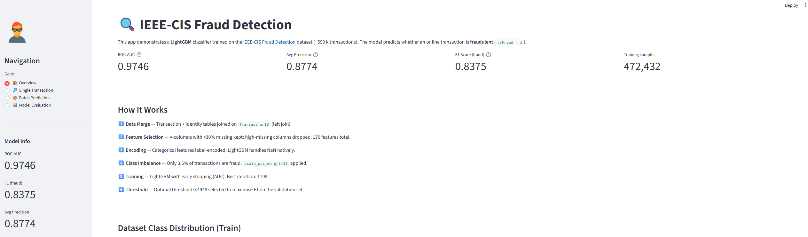
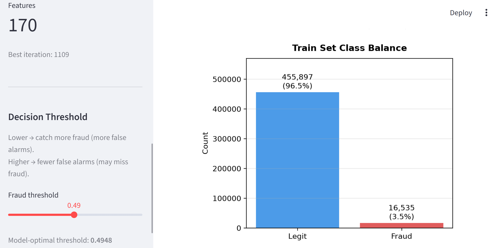
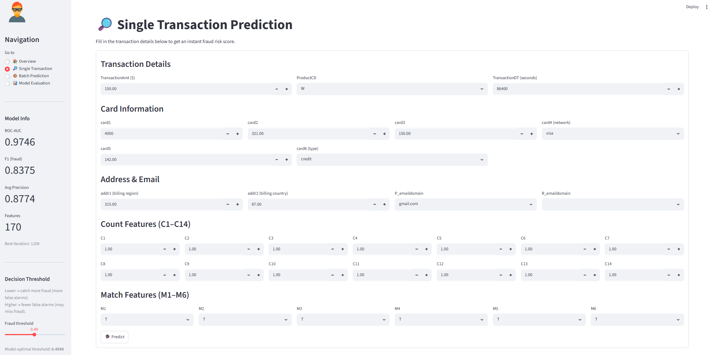
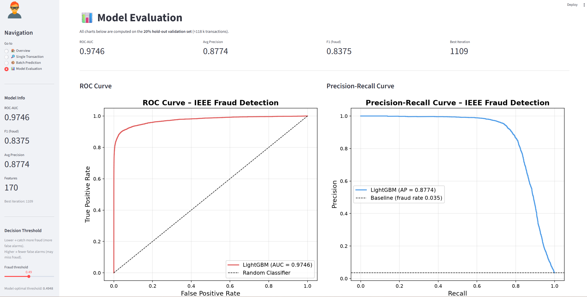
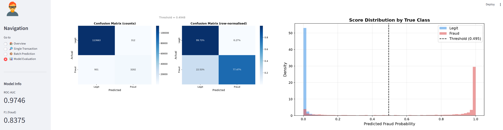
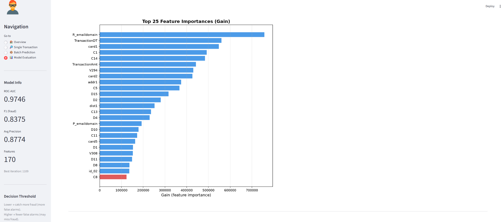
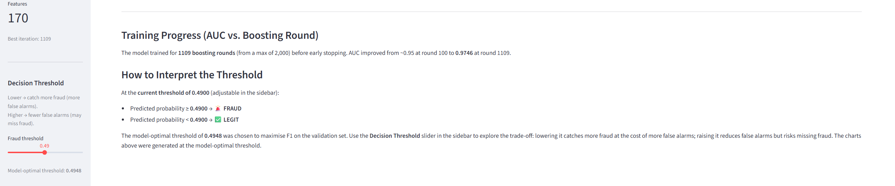
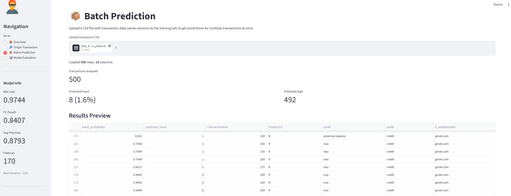
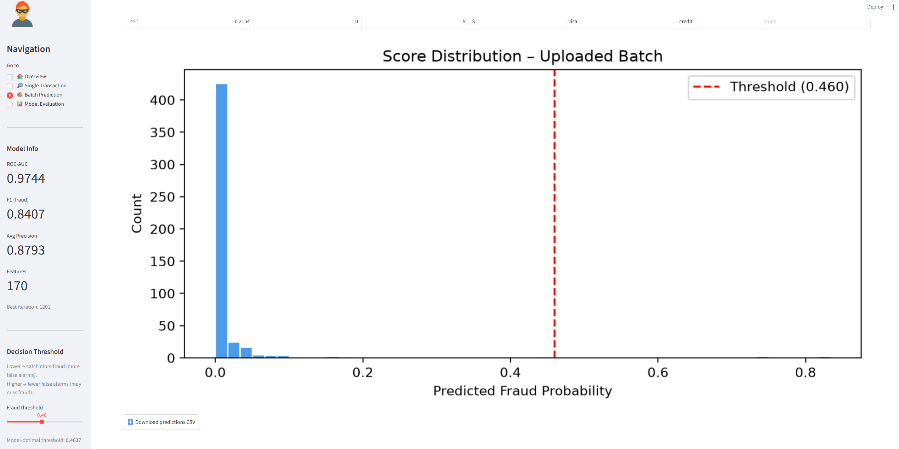

</details>

## Results

| Metric | Value |
|---|---|
| ROC-AUC | **0.9744** |
| Average Precision | **0.8793** |
| F1 Score (fraud) | **0.8407** |
| Optimal Threshold | 0.4637 |
| Best Iteration | 1,201 |
| Training Samples | 472,432 |
| Features | 170 |
| Fraud Rate (train) | 3.5% |

---

## Project Structure

```
ieee-fraud-detection/
├── train_transaction.csv          # Raw training data – transactions
├── train_identity.csv             # Raw training data – identity
├── test_transaction.csv           # Test transactions
├── test_identity.csv              # Test identity
├── test_transaction_pred.csv      # Sample batch for demo (500 rows)
├── sample_submission.csv          # Kaggle submission format
│
├── train_model.py                 # Training script
├── app.py                         # Streamlit demo app
│
└── model/
    ├── lgbm_fraud_model.txt       # Trained LightGBM booster
    ├── feature_info.pkl           # Encoders, feature names, threshold
    ├── metrics.json               # Validation metrics
    ├── selected_cols.json         # Column selection from training
    └── charts/
        ├── roc_curve.png
        ├── pr_curve.png
        ├── confusion_matrix.png
        ├── feature_importance.png
        └── score_distribution.png
```

---

## Approach

### 1. Data

The dataset has two tables joined on `TransactionID`:

- **Transaction table** — 590,540 rows, 394 columns. Contains payment amounts, card info, address, email domains, count features (C1–C14), timedelta features (D1–D15), match flags (M1–M9), and 339 Vesta-engineered V-features.
- **Identity table** — 144,233 rows, 41 columns. Contains device, network, and behavioral fingerprint features (id_01–id_38).

Tables are merged with a **left join** so that all transactions are retained (identity info is optional).

### 2. Feature Selection

V-columns with **≥ 30% missing values** are dropped, retaining 86 of 339. Identity columns with **≥ 80% missing** are also dropped. This leaves **170 features** total while keeping memory usage under 1.1 GB.

### 3. Encoding

Categorical features (`ProductCD`, `card1–6`, `addr1–2`, email domains, `M1–M9`, `DeviceType`, `DeviceInfo`, `id_12–id_38`) are **label-encoded**. NaN values become the string `"nan"` via `astype(str)`, which is a valid encoder class. Unseen values at inference time fall back to `le.classes_[0]`.

LightGBM receives all columns as plain numerics and handles remaining NaN natively — no imputation required.

### 4. Class Imbalance

Only **3.5%** of transactions are fraudulent. `scale_pos_weight = 27.6` (ratio of negatives to positives) is applied to weight the minority class during training.

### 5. Model

**LightGBM** (`lgb.train`) with:

```python
params = {
    "objective":          "binary",
    "metric":             "auc",        # early stopping tracks AUC only
    "learning_rate":      0.05,
    "num_leaves":         255,
    "min_child_samples":  20,
    "feature_fraction":   0.8,
    "bagging_fraction":   0.8,
    "bagging_freq":       5,
    "scale_pos_weight":   27.6,
}
```

Trained for up to 2,000 rounds with **early stopping** (patience = 100) on a stratified 80/20 train-validation split.

### 6. Threshold Selection

The decision threshold is set to the value that **maximises F1** on the validation set (via the precision-recall curve), rather than the default 0.5. The optimal threshold of **0.4637** is saved alongside the model and exposed as an adjustable slider in the Streamlit app.

---

## Evaluation Charts

| ROC Curve | Precision-Recall Curve |
|---|---|
| 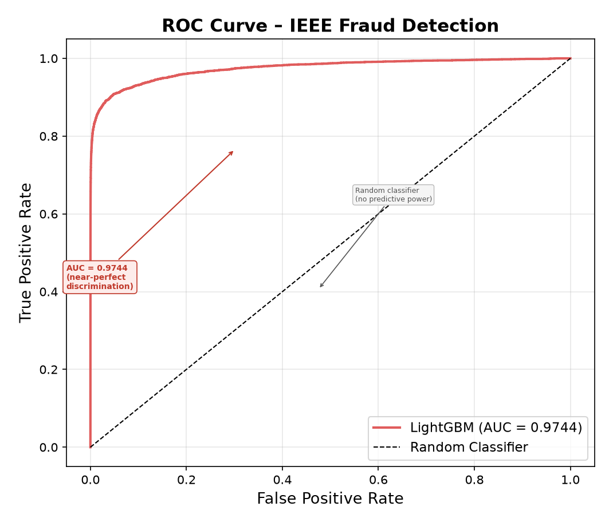 | 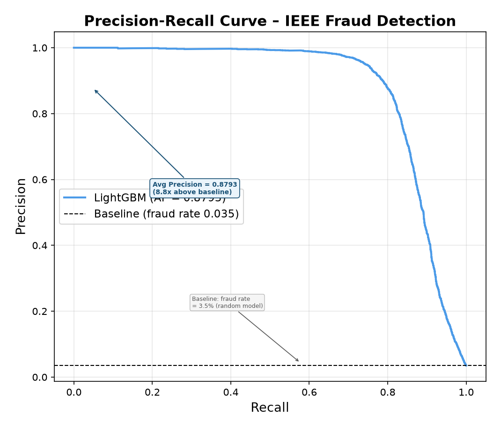 |

| Confusion Matrix | Score Distribution |
|---|---|
| 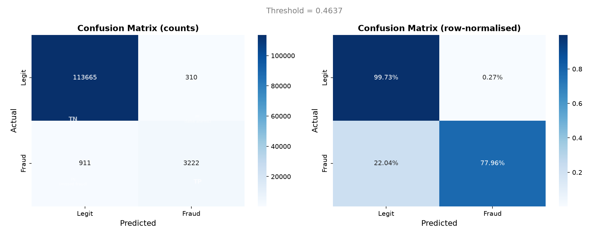 | 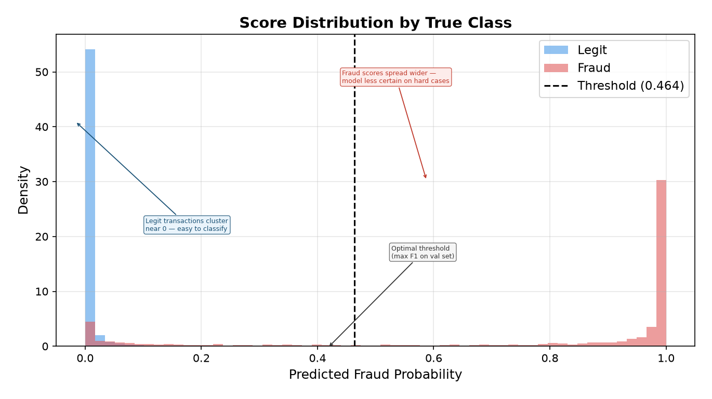 |

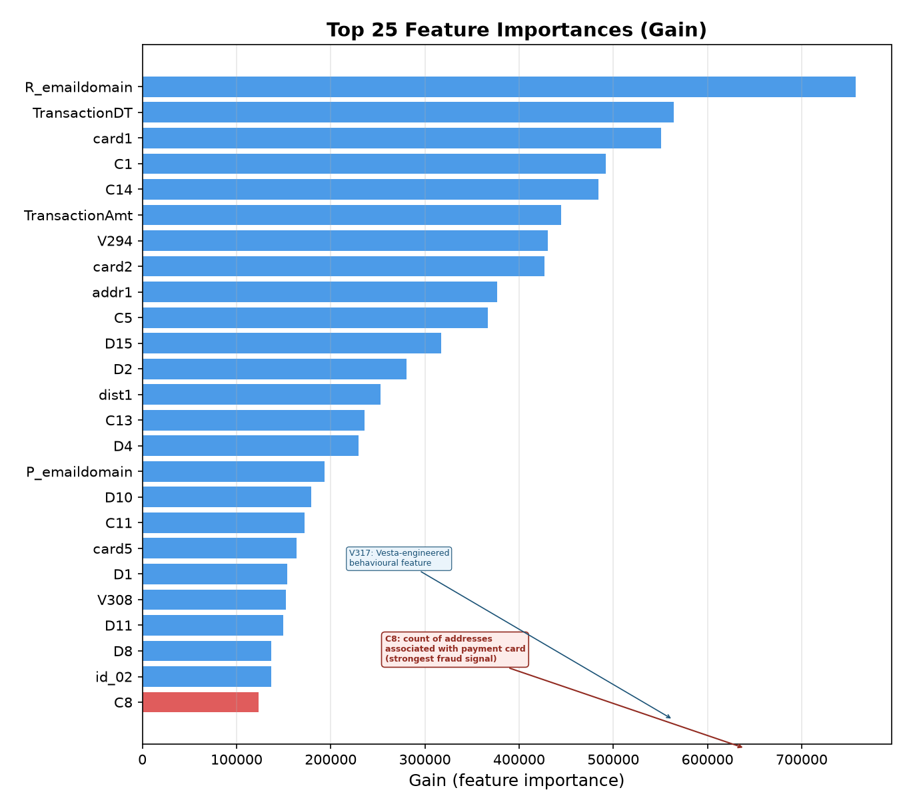

---

## Getting Started

### Prerequisites

- Python 3.10+
- The dataset CSV files (see [IEEE-CIS Fraud Detection](https://www.kaggle.com/competitions/ieee-fraud-detection) dataset.)

### Installation

1. **Clone the repository**

   ```bash
   git clone https://github.com/CyprianFusi/ieee-fraud-detection.git
   cd ieee-fraud-detection
   ```

2. **Create and activate a virtual environment**

   ```bash
   python -m venv .venv

   # Windows
   .venv\Scripts\Activate.ps1

   # macOS / Linux
   source .venv/bin/activate
   ```

3. **Install dependencies**
  
```bash
pip install lightgbm scikit-learn pandas numpy joblib matplotlib seaborn streamlit
```

### Train the Model

```bash
python train_model.py
```

This reads `train_transaction.csv` and `train_identity.csv`, trains the model, saves artefacts to `model/`, and generates evaluation charts in `model/charts/`.

### Run the Streamlit App (after activating the venv)

```bash
streamlit run app.py
```

Then open [http://localhost:8501](http://localhost:8501).

---

## Streamlit App

The app has four pages:

| Page | Description |
|---|---|
| **Overview** | Dataset summary, pipeline explanation, class distribution chart |
| **Single Transaction** | Form-based input for one transaction → instant fraud probability + gauge chart |
| **Batch Prediction** | Upload a CSV → scores all rows, shows score distribution, downloadable results |
| **Model Evaluation** | All five evaluation charts + threshold interpretation guide |

A **Decision Threshold** slider in the sidebar lets you tune the fraud/legit boundary in real time — lower to catch more fraud (more false alarms), higher to reduce false alarms (risk missing fraud). The model-optimal threshold is shown as a reference.

For batch prediction, use the included `test_transaction_pred.csv` (500 rows, 19 columns) as a ready-to-upload sample.

---

## Dataset

Source: [IEEE-CIS Fraud Detection — Kaggle](https://www.kaggle.com/competitions/ieee-fraud-detection)

> Vesta Corporation provided the dataset. Transaction labels are based on reported chargebacks: `isFraud = 1` means a confirmed fraudulent transaction or one linked to a fraud account via shared card, email, or billing address within 120 days.

The data files are **not included** in this repository due to Kaggle's terms of service. Download them from Kaggle and place them in the project root before running the training script.
